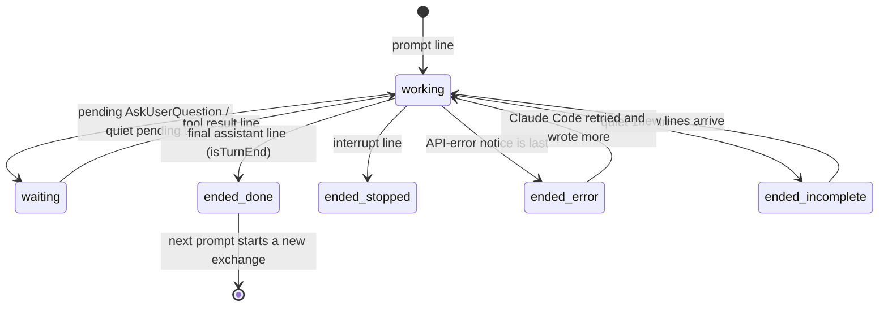
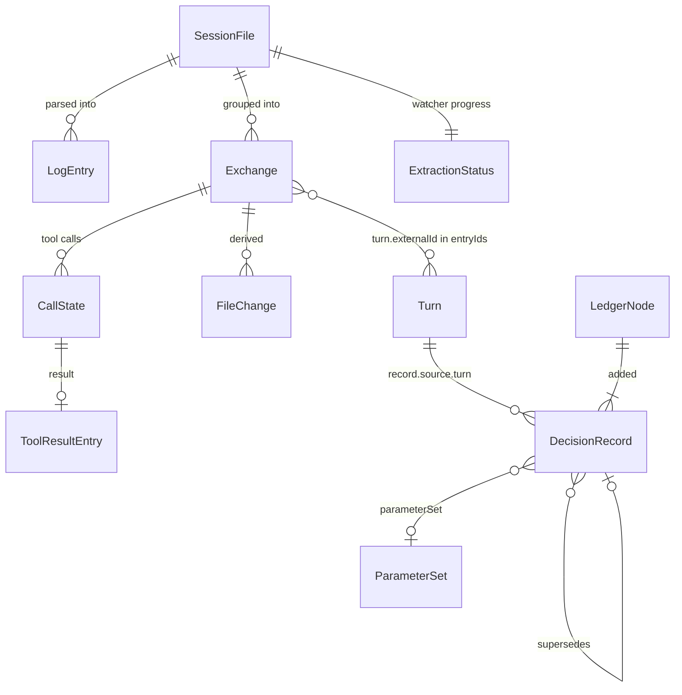

# Data model

The ledger record shape (`src/core/records.ts`: `Turn`, `DecisionRecord`, `LedgerNode`, `ParameterSet`) is **unchanged**. This document defines the in-memory models the companion panel derives, and how.

## Sources of truth

Everything the panel shows is derived from these sources. Apart from them, nothing is persisted and there's no cache (D-017).

| Source | Owner | What it gives the panel |
|---|---|---|
| Claude Code session logs `~/.claude/projects/<slug>/<sessionId>.jsonl` | Claude Code (read-only for us) | Prompts, replies, tool calls and results, stop reasons, timestamps |
| `.ledger/objects`, `HEAD`, `refs/` | core | Records, the turns they're grounded to, nodes, parameter sets |
| `.ledger/watch.json` | watcher | Per session file: committed `offset` (a used chat starts at 0, D-020) |
| `workspaceState["ledger.panel.follow"]` | panel | The user's follow choice: `{ mode: "auto" }` or `{ mode: "pinned", sessionId }` |
| Webview `setState` | webview | UI-only state: open disclosures, scroll position |

Immutable ledger objects (records, turns, nodes, parameter sets) are memoised in memory by hash. That's an index, not a cache: a hash's content can't change.

---

## 1. `LogEntry`: the parser's output (`claude-log`)

One JSONL line becomes zero or more entries. Entries are format-agnostic: no other module sees raw JSON.

```ts
interface EntryBase {
  uuid: string;          // the line's uuid (A4)
  sessionId: string;
  timestamp: string;     // ISO 8601
  startOffset: number;   // byte offset of the line's start in its file
  endOffset: number;     // byte offset just past the line's newline
}

type LogEntry = PromptEntry | AssistantEntry | ToolResultEntry | InterruptEntry;

interface PromptEntry extends EntryBase {
  kind: "prompt";                     // a message the person typed (A5)
  text: string;                       // harness elements removed; may contain code
  permissionMode?: "default" | "acceptEdits" | "plan" | "bypassPermissions" | string;
}

interface AssistantEntry extends EntryBase {
  kind: "assistant";
  messageId?: string;                 // shared by every line of one model message (A6)
  model?: string;                     // never "<synthetic>"
  blocks: AssistantBlock[];
  stopReason?: string;                // "tool_use" | "end_turn" | "max_tokens" | "stop_sequence" | "refusal" | …
  apiError?: string;                  // set (and blocks empty) when this is Claude Code's API-error notice (A6)
}

type AssistantBlock =
  | { type: "text"; text: string }    // as Claude wrote it, code included
  | { type: "thinking" }              // content dropped
  | { type: "toolUse"; call: ToolCall };

interface ToolCall {
  id: string;                         // tool_use id
  tool: string;                       // "Bash", "Edit", "AskUserQuestion", …
  target?: string;                    // file path, URL, pattern or sub-agent description
  command?: string;                   // Bash only, exact
  description?: string;               // Claude's short description (Bash, Task)
  questions?: AskedQuestion[];        // AskUserQuestion only
  edit?: FileChangeFact;              // Edit/MultiEdit/Write/NotebookEdit, counted from the input (fallback)
}

interface AskedQuestion { question: string; header?: string; options: { label: string; description?: string }[]; multiSelect: boolean }

interface FileChangeFact {
  path: string;                       // absolute, as logged
  kind: "added" | "modified";
  added?: number;                     // lines; absent when unknown (NotebookEdit)
  removed?: number;
}

interface ToolResultEntry extends EntryBase {
  kind: "toolResult";
  toolUseId: string;
  isError: boolean;
  rejected: boolean;                  // the person denied the tool in Claude Code (A9)
  fileChange?: FileChangeFact;        // from toolUseResult, more exact than ToolCall.edit (A7)
  answers?: { question: string; answer: string }[]; // AskUserQuestion (A10)
}

interface InterruptEntry extends EntryBase { kind: "interrupt" }   // "[Request interrupted by user…]" (A11)
```

**Rules**
- File contents, `old_string`/`new_string`, patches and tool output are reduced to counts inside `parse.ts` and never appear in an entry.
- Sidechain, meta, compact-summary, `<synthetic>` non-error notices, attachments and system lines produce no entry.
- `isTurnEnd(e)` is true for an `AssistantEntry` whose `stopReason` is anything except `"tool_use"` (and isn't absent). It is the one rule for "the reply is finished"; the watcher and the panel both use it.
- Entries from one line share `startOffset`/`endOffset`. A half-written last line is never parsed.

`RawTurn` (core, unchanged shape) is projected from entries by `watcher/turns.ts` exactly as `transcript.ts` does today: prompts become human turns; assistant text plus one-line tool notes (`[Edit client.ts]`, `[ran: install deps]`) become AI turns; consecutive AI fragments merge, keeping the first fragment's `uuid` as `externalId`. API-error notices and tool results produce no turn.

---

## 2. `Exchange`: the panel's domain model (`panel/exchanges.ts`)

An **exchange** is one human prompt plus everything until the next prompt in the same session.

```ts
interface Exchange {
  id: string;                    // the prompt entry's uuid: stable across reloads, equals the human Turn's externalId
  sessionId: string;
  prompt: { text: string; timestamp: string; permissionMode?: string };
  entryIds: Set<string>;         // every entry uuid in the exchange (for linking records)
  startOffset: number;           // prompt line start
  endOffset: number;             // end of the last entry so far
  model?: string;                // first assistant model seen
  parts: ReplyPart[];            // in log order
  calls: Map<string, CallState>; // by tool_use id
  lastAssistant?: AssistantEntry;
  interrupted: boolean;
  lastEntryAt: string;           // timestamp of the last entry
}

type ReplyPart = { type: "text"; text: string } | { type: "step"; callId: string };

interface CallState { call: ToolCall; at: string; result?: ToolResultEntry }
```

### Derived values (pure functions, recomputed, never stored)

| Value | Rule |
|---|---|
| `phase` | `"ended"` if `lastAssistant` passes `isTurnEnd` and no call is pending; or `interrupted`; or the last assistant entry is an `apiError`; or **stale**: the session file has been quiet `STALE_EXCHANGE_MS` (10 min) with no certain wait. Otherwise `"working"`. |
| `endReason` | `"stoppedByUser"` if interrupted; `"error"` if the last assistant entry has `apiError`; `"incomplete"` if stale; else `"done"`. |
| `durationMs` | last entry time − prompt time. |
| `activity` (while working) | From the newest pending call: the status wording table in `docs/ui/chat-panel.md`, built from `tool` + `target`/`description`. With no pending call: "Thinking…". |
| `waiting` | See [Waiting detection](#waiting-detection). |
| `files` | One row per path, in first-touch order. Uses `result.fileChange` when present, else `call.edit`. Only calls whose result isn't an error count. Counts are summed per path. `kind` is `added` if the first successful change created the file. |
| `steps` | One per call: tool, target, outcome `ran` / `failed` / `denied` / `pending`. |
| `questions` | Every AskUserQuestion call (with answers once the result arrives), plus a **text question** when the reply ended and its final paragraph ends with `?`. |

### Waiting detection

Computed by `detectWaiting(exchange, now, quietSince)`, with an honest confidence level.

| Signal | Kind | Confidence | Reliability |
|---|---|---|---|
| An `AskUserQuestion` call has no result | question | `certain` | Reliable while A8/A10 hold: that tool always blocks on the person. |
| Phase ended with `done`, and the last text part's final paragraph ends with `?` (ignoring trailing whitespace and closing quotes or brackets) | question | `likely` | Heuristic. Rhetorical questions give false positives. Questions phrased without `?` ("Let me know which you prefer.") are missed. Cleared when the next prompt arrives. |
| Any other call has no result, the file has been quiet `PERMISSION_QUIET_MS` (3 s), the tool isn't in `TOOLS_THAT_NEVER_ASK` (Read, Glob, Grep, TodoWrite, Task, Agent), the exchange's `permissionMode` isn't `bypassPermissions`, and (for edit tools) it isn't `acceptEdits` | permission | `possible` | **Unreliable by nature.** The log looks the same while a long command runs (tests, installs) as while Claude Code waits for approval. Allow rules in the person's Claude Code settings also aren't visible. The panel says "may be waiting" and never shows a badge for it. |

When the call's result arrives: `rejected` → resolved line "Denied in Claude Code"; otherwise the step shows as ran or failed.

### Exchange lifecycle (derived)



`waiting` is the `waiting` field set while the phase is `working`. A `likely` text question sits on `ended_done`.

---

## 3. Linking ledger records to exchanges (`panel/linker.ts`)

1. For each record in `ledger.stateAt()` (**current branch only**, matching the tree view), read `turn = ledger.turn(record.source.turn)`.
2. Keep it if `turn.origin === "claude-code"` and `turn.session === followed sessionId`.
3. Its exchange is the one whose `entryIds` contains `turn.externalId`. A human turn's `externalId` is the prompt uuid, and an AI turn's is the uuid of its first fragment, so both fall inside the exchange they came from.
4. Its node is found by walking `ledger.log()` from HEAD and indexing each node's `added`. The index is extended incrementally when HEAD moves.
5. `replaces` comes from `record.supersedes` → that record's `seq`, `decision` and `author.name`. Grades are named with `namedGrades` (moved to core).

Records whose turn has no `externalId` (origins `vscode-chat` and `cli`) aren't shown in the panel. They stay in the tree view.

### Decision-section state per exchange (`panel/extraction.ts`)

Inputs: the exchange, its linked records, and `ExtractionStatus` for its file. Evaluated in this order:

| State | When |
|---|---|
| `off` | Agent watching is disabled (`ledger.agents.watchClaudeCode` or the toggle command). |
| `notYet` | Phase is `working` (shown only if records already exist, as "Decisions so far"). |
| `done` | `exchange.endOffset <= status.committedOffset`. The count may be 0 ("No decisions in this reply"). |
| `failed` / `noModel` / `configInvalid` | The status has a `failure` and the exchange isn't committed. The kind comes from the error class. |
| `extracting` | Otherwise: the reply ended and hasn't been committed yet. |

There is no "skipped" state: a chat the extension is used on is processed from its first message (D-020), so every exchange in it eventually reaches `done` or an error.

---

## 4. View model

The protocol types (`ExchangeView`, `DecisionView`, `PanelError`, …) are defined in [api.md](api.md). They're a projection of `Exchange` + linked records + section state. **Only display data crosses**: display paths relative to the workspace (absolute only when outside it), no byte offsets, no log file paths.

## 5. Entity relationships



## 6. Invariants

1. Every exchange starts with exactly one `PromptEntry`. Entries before a session's first prompt belong to no exchange.
2. `Exchange.id` = prompt uuid = the human `Turn.externalId` for that prompt.
3. Entries are applied in byte-offset order. An entry is never applied twice (the builder ignores `endOffset <= lastApplied`).
4. A `ToolResultEntry` attaches only to a call with the same id in the same exchange. Orphans are ignored and counted for drift reporting.
5. No `LogEntry`, `Exchange` or view carries file contents, patches or tool output. Assistant text (which may contain code) is display-only and never reaches a model from the panel.
6. A decision shown under an exchange is a record in the current branch's state whose turn maps into that exchange. Count shown = records listed.
7. Rebuilding from the log and the ledger after a reload gives the same exchanges and sections as the live build.

## 7. Persisted-state change

`watch.json` keeps its `{ offset }` shape. What changes is the first offset: when the watcher first tracks a session file it starts at 0, never at the file's size (D-020). Entries already in `watch.json` are kept as they are. The ledger object shapes don't change.

---

## Claude Code log format assumptions

The format isn't documented. Every assumption below is implemented only in `src/claude-log/parse.ts` (or `discover.ts` for A1), cited by id, and covered by a fixture test in `test/fixtures/claude-log/`. **V** = verified against real logs on 2026-11-27; **I** = inferred, to be confirmed with a recorded fixture before the step that depends on it.

| Id | Assumption | Status | If it breaks |
|---|---|---|---|
| A1 | Sessions are `~/.claude/projects/<slug>/<sessionId>.jsonl`; slug = cwd with non-alphanumerics → `-`; otherwise the first `cwd` in the head decides. Sub-agent logs are under `<slug>/<sessionId>/subagents/` | V | No session found; the `ledger.agents.claudeProjectsDir` override |
| A2 | One JSON object per line, append-only, UTF-8, LF (a CR is trimmed); the last line can be partial while it is written | V | Partial lines wait for the next poll |
| A3 | Top-level `type`: `user` and `assistant` are conversation. `system` (incl. `compact_boundary`), `attachment`, `summary`, `file-history-snapshot` and unknown types are ignored | V | Unknown types are skipped; drift report |
| A4 | Conversation lines carry `uuid`, `parentUuid`, `sessionId`, `timestamp`, `cwd`, `isSidechain`, `isMeta`, `isCompactSummary`, `isVisibleInTranscriptOnly`; sidechain, meta and compact lines aren't conversation | V | Sub-agent chatter shows as conversation |
| A5 | A person's prompt is a `user` line with string or text-block content, `origin.kind === "human"` in newer logs (absent in older ones), harness elements removed (existing allowlist rule); `permissionMode` is on it | V | Harness text is credited to the person |
| A6 | Assistant lines have `message.model`, `message.id`, `message.stop_reason`. Each content block is written as its own line with the same `message.id`, and every line repeats the stop reason (`tool_use` while tools follow, `end_turn` etc. at the end). Model `<synthetic>` is a Claude Code notice; with `isApiErrorMessage: true` it is an API error | V | Phase never reaches `ended`; stale fallback |
| A7 | Tool results are `user` lines with `tool_result` blocks (`tool_use_id`, `is_error`) plus top-level `toolUseResult`: Edit/MultiEdit → `filePath`, `structuredPatch[{oldStart, oldLines, newStart, newLines, lines}]`; Write → `type: "create" \| "update"`, `filePath` | V | Counts fall back to tool inputs |
| A8 | Tool inputs: Edit `{file_path, old_string, new_string}`, MultiEdit `{file_path, edits[]}`, Write `{file_path, content}`, NotebookEdit `{notebook_path, new_source, edit_mode?}`, Bash `{command, description?}`, Read/Grep/Glob `{file_path \| pattern \| path}`, WebFetch `{url}`, Task/Agent `{description}`, AskUserQuestion `{questions:[{question, header?, options:[{label, description?}], multiSelect?}]}` | V | Status text degrades to the tool name |
| A9 | The `tool_use` line is written **before** Claude Code asks permission, and the result after the decision (I). A denial's result text starts "The user doesn't want to proceed with this tool use" (V) and has `is_error: true` (I) | V/I | Denials show as "failed"; no permission wait is ever detected |
| A10 | An answered AskUserQuestion's result has `toolUseResult.answers` (question → answer) and text "User has answered your questions: …" (both seen; exact shape to pin in a fixture) | V/I | "Answered in Claude Code" without the answer |
| A11 | An interrupt is a `user` line whose text is `[Request interrupted by user]` or `[Request interrupted by user for tool use]` | V | "Stopped by you" shows as incomplete |
| A12 | A new conversation in Claude Code creates a new file; file basename = `sessionId` | V | The follower still works from file mtimes |
| A13 | Resuming a conversation may write a new file whose first lines repeat earlier history | I | Duplicate exchanges in a resumed session; harmless |
| A14 | `entrypoint` is `"claude-vscode"` for the VS Code extension (V) and something else for the terminal (I). Not used for logic | V/I | None |

**Fixtures are synthetic.** They're written by hand to match the real structure; real session logs are never committed, because they can hold secrets and code. When an **I** assumption is confirmed, record the Claude Code `version` field from the log you checked in the fixture's header comment.
