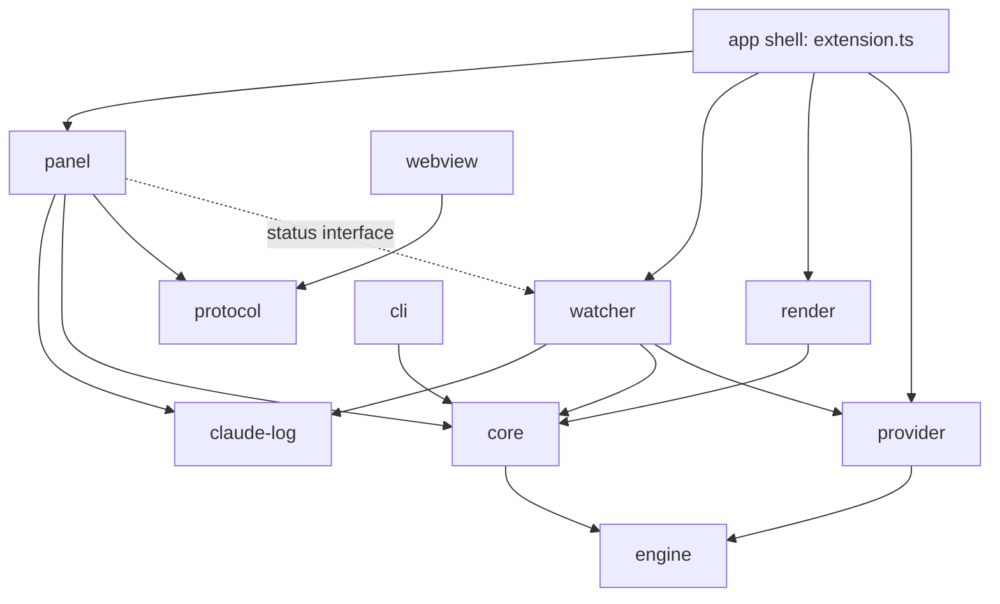

# Modules

Decision Ledger is one VS Code extension (a modular monolith) plus the independent `engine/` package. This document covers the whole extension, with the **companion panel** as the feature being added.

The companion panel is a webview view that follows the Claude Code session the user is typing into (in the official Claude Code extension), by reading the JSONL log Claude Code already writes. It shows each exchange processed: questions, possible permission prompts, decisions, files changed, and the full reply one click away. It is **read-only**: Decision Ledger never starts, drives or signs in to Claude (D-002).

## Rules

- A module owns its data. Others use its public entry point (`index.ts`), never deep files.
- No circular dependencies. Dependencies point down the diagram below.
- **Only `claude-log` knows Claude Code's JSONL format.** Everything else consumes `LogEntry` (D-004).
- **Only `core` (via `ingest`) calls a model.** The panel, protocol and webview never import model code, so rule 6 can't be broken from the panel (D-018).
- Only `core` reads or writes `.ledger/`. The panel reads ledger objects through `Ledger`, and reads extraction progress through the watcher's status interface, never `watch.json`.

## Module map

| Module | Folder | Owns | Exposes | Depends on |
|---|---|---|---|---|
| **engine** (fixed) | `engine/` | Prompting, reply parsing, grading guarantees | `extractDecisions`, contract types, errors, model adapters | nothing internal |
| **core** (ledger) | `src/core/` | `.ledger/` store (objects, HEAD, refs, `config.json`, meta files), turn/record/node/parameter shapes, the ingest pipeline (code stripping, batching, chunking), identity, retry backoff | `Ledger`, record types, `ingest`, `ingestBacklog`, `RawTurn`, `stripCode`, `loadParameters`, `namedGrades` (moved here from `render.ts`), `localHumanName`, `RetryBackoff` | engine |
| **claude-log** (new) | `src/claude-log/` | Claude Code's JSONL format: session discovery, byte-offset tailing, line parsing into `LogEntry`, format-drift detection | `SessionLogSource`, `LogEntry` types, `isTurnEnd`, `parseLogLines`, `findSessionFiles`, `isInsideWorkspace` | Node `fs`/`path` only |
| **watcher** (extraction pipeline) | `src/watcher/` | Turning log entries into ledger records: entry → `RawTurn` projection, pending backlog per file, flush policy, committed offsets in `.ledger/watch.json`, extraction status | `AgentWatcher` (start/stop/retryNow), `ExtractionStatusProvider` | claude-log, core, engine (error classes only), provider |
| **provider** | `src/provider.ts` | Choosing the extraction model (SecretStorage keys, Copilot) | `getEngine`, secret key names | engine |
| **panel** (new, extension side) | `src/panel/` | Which session is followed, the exchange model, waiting detection, file changes, linking ledger records to exchanges, mapping to view models, the webview lifecycle and its CSP | `PanelController` (a `WebviewViewProvider`), `registerPanel` | claude-log, core (read-only queries), watcher (status interface), protocol |
| **protocol** (new, shared) | `src/protocol/` | The extension↔webview contract: message and view types, error format, version, validators | types, `PROTOCOL_VERSION`, `parseHostMessage`, `parseWebviewMessage` | nothing (no `vscode`, no DOM) |
| **webview** (new, browser side) | `src/webview/` | Rendering the panel; UI-only state (open disclosures, scroll) | nothing (it is an app) | protocol |
| **app shell** | `src/extension.ts` | Activation and wiring; the decisions tree view; commands | `activate` | everything above |
| **render** | `src/render.ts` | Markdown documents for records, state and diffs (editor tabs) | `recordDoc`, `stateDoc`, `diffDoc`, … | core |
| **cli** | `src/cli.ts` | The `ledger` command | binary | core, engine |
| **chat** (legacy, removed) | `src/chat.ts` | The deprecated `@ledger` chat participant | | deleted in the last build step (D-015) |

The webview is a separate program (it runs in the webview's browser context); it reaches the extension only through `postMessage`, validated on both sides.

## Responsibilities in detail

### claude-log
- **`discover.ts`**: finds this workspace's session files (moved unchanged from `core/transcript.ts`, plus a per-file memo of "is this file in the workspace", since a file's recorded `cwd` never changes). Top-level `*.jsonl` only; sub-agent logs in `<session>/subagents/` are ignored.
- **`parse.ts`**: one JSONL line → zero or more `LogEntry`. Every format assumption (A1–A14 in [data-model.md](data-model.md#claude-code-log-format-assumptions)) lives here and is cited by id in a comment. Tool inputs and results are reduced to facts (path, line counts, command, question): **file contents and tool output never leave this module.** Harness stripping and the `<synthetic>` rule move here from `transcript.ts`.
- **`source.ts`**: `SessionLogSource`, **the one reader** (D-003). Polls discovered files, keeps one byte cursor per file, reads complete lines only, parses each line once, and emits `LogBatch`es to every subscriber. A synchronous `read(file, from, to)` lets a subscriber backfill through the same parser with no gap or overlap. The followed file is polled fast (D-005).
- Reports format drift (many complete lines, zero recognised entries) once per file.

### watcher
- Subscribes to the source instead of reading files.
- **`pipeline.ts`** holds all of the logic without vscode (so it's unit-tested); **`watcher.ts`** is the thin VS Code adapter: settings, the model, warnings with fixes.
- **`turns.ts`**: `LogEntry[]` → `RawTurn[]` (moved from `transcript.ts`: one-line tool notes, merge consecutive AI fragments, end offsets). Same output as today; the existing tests move with it.
- Flushes a file's backlog when the turn ends (`isTurnEnd`), when the file has been quiet `idleSeconds`, or at 24 turns (D-011).
- Tracks every used chat from offset 0, so its earlier exchanges are extracted too (D-020).
- Persists `{ offset }` per file in `watch.json` and exposes `ExtractionStatusProvider` (committed offset, in-flight range, last failure, next retry) so the panel can say "Extracting…", "N decisions" or "Couldn't extract" per exchange (D-010).
- Keeps today's error handling: per-file backoff, each error reported once, toast with fixes.

### panel (extension side)
- **`follower.ts`**: `SessionFollower` picks the session: auto-follow the newest human prompt in this workspace, or a session the user pinned (D-014).
- **`exchanges.ts`**: `ExchangeBuilder`, incremental `LogEntry[]` → `Exchange[]`. Pure.
- **`phase.ts`**: `phaseOf`, which works out working/ended and the end reason. Pure.
- **`waiting.ts`**: `detectWaiting(exchange, now, quietSince)`, with a confidence level. Pure (D-007).
- **`files.ts`**: file changes per exchange from tool facts. Pure (D-008).
- **`activity.ts`**: the one-line status text ("Editing src/db/client.ts…"). Pure.
- **`linker.ts`**: `DecisionLinker`, which maps ledger records on the current branch to exchanges (via `turn.externalId`) and to the node that added them. It memoises by hash, which is safe because objects are immutable (D-009).
- **`extraction.ts`**: combines watcher status and linker results into each exchange's decision-section state. Pure.
- **`view.ts`**: `Exchange` + decisions → protocol `ExchangeView`. Pure. Display paths only; no byte offsets or log paths cross to the webview.
- **`errors.ts`**: the one place domain errors (`ApiError`, `NoModelError`, `ModelOutputError`, `ConfigError`, fs errors) become a protocol `PanelError`.
- **`session-panel.ts`**: `SessionPanel`, the orchestrator. It owns subscriptions, rebuilds on `ready`, throttles upserts, runs the waiting timer and computes the badge count. It talks to VS Code only through two ports (`WebviewPort`, `HostCommands`), so it is tested without VS Code.
- **`actions.ts`**: handlers for webview actions (open record, reveal node, open file, retry, set up a model, choose session, load earlier); each validates its arguments against the current model.
- **`controller.ts`**: `PanelController`, the thin VS Code adapter. It implements `WebviewViewProvider`, implements the two ports (postMessage, view badge, commands, quick picks) and hands everything to `SessionPanel`.
- **`html.ts`**: the webview HTML shell with a strict CSP and a nonce.

### protocol
Types for every message in both directions, view types, `PanelError` and its codes, `PROTOCOL_VERSION`, and hand-written validators (same style as `engine/src/schemas.ts`). Compiled into both the extension and the webview. See [api.md](api.md).

### webview
- **`bridge.ts`**: `acquireVsCodeApi`, validates every inbound message, sends actions.
- **`model/`** (no DOM; unit-tested in Node): the state reducer, formatting ("Done in 3m 41s"), status copy, and a safe markdown parser that produces a token tree.
- **`view/`** (DOM): shared UI pieces (`components/ui/`) and session components (`features/session/`), built with DOM APIs and `textContent`, never `innerHTML` with log text.
- **`styles/`**: `tokens.css` (moved from `docs/ui/`) and `panel.css`.

## What the UI docs assume vs. what is built

`docs/ui/` was designed for a panel with its own chat. These differences apply; the ui-designer should update the previews (build step 20).

| UI doc says | Built as |
|---|---|
| Composer, Send, Stop, Esc, draft, "Try again", "New conversation [+]" | **Removed.** No input of any kind. The user types in Claude Code. |
| Permission card with Allow / Allow for session / Deny | **Read-only card**: tool, exact command or file path and +/- counts, Claude's stated description. Status: "Claude Code may be waiting for your permission". No buttons. Resolved line: "Ran Bash: npm install" or "Denied in Claude Code: …" (who approved, and the scope, aren't in the log). |
| Question card with option buttons and answering composer | **Read-only card**: question in full, options as a plain list, "Answer in Claude Code". After the answer: the answer if the log has it, else "Answered in Claude Code". |
| Badge (1) while waiting | Badge only for **certain** or **likely** waiting (AskUserQuestion pending, or a reply ending in a question). A **possible** permission wait shows in the status line only (D-007). |
| Text streams token by token with a caret | Text arrives **a block at a time**, as each JSONL line is written. No caret. |
| States 13/14: Claude Code not installed / not signed in | One empty state: **"No Claude Code session found for this workspace"**, with a hint that depends on whether the Claude Code extension is installed, and **Check again**. |
| State 10: "Claude Code stopped with an error" + Try again | Same callout with the error text from the log. Instead of a button: "Ask again in Claude Code". |
| File row opens a before/after diff | File row **opens the file**. No diffs in v1 (D-008). Deleted and renamed files aren't detected. |
| Extraction states 5, 6, 8, 11, 12 | Kept. Automatic retry follows the watcher's existing backoff (30 s doubling to 10 min) rather than "3 tries". New state: **off** (watching disabled). No "skipped" state: a used chat is processed from its first message (D-020). |
| "Saved as node … on main" | Kept. It can list more than one node when a batch boundary split an exchange. |
| (none) | New: a session line, "Following: {first prompt} · last active 2m ago · Switch session", and "N other active sessions". |
| Save a missed sentence as a decision | Deferred. Room is reserved in the protocol and the engine (D-016). |
