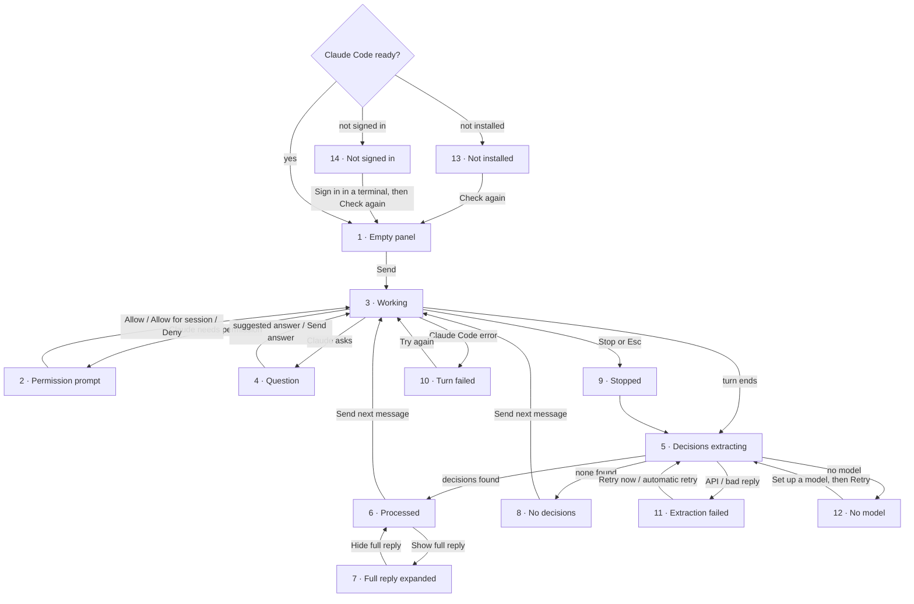
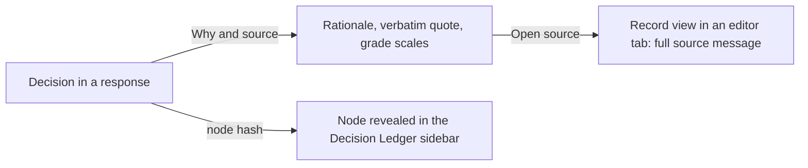
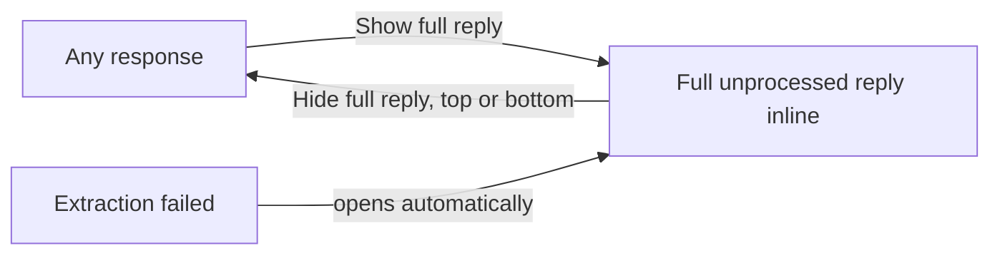
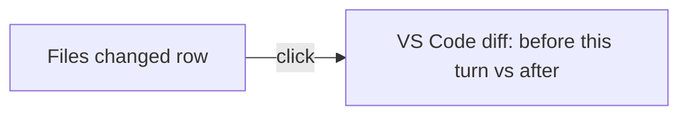

# Flows: chat panel

There is only one screen (the chat panel, [chat-panel.md](chat-panel.md)). The flows below move between its states. State numbers match the preview's switcher; clicking the controls named here in [`previews/chat-panel.html`](previews/chat-panel.html) follows the same arrows.

## 1. Send a message and read the result

## 2. Check a decision against its source

## 3. Find something the engine missed

## 4. Review what changed

